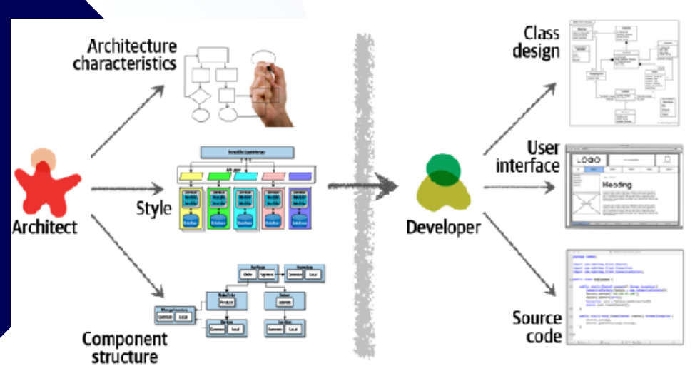
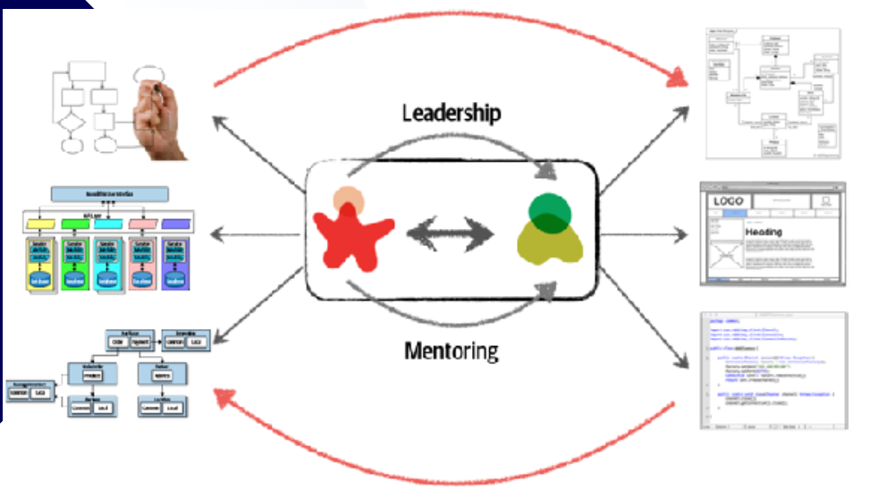
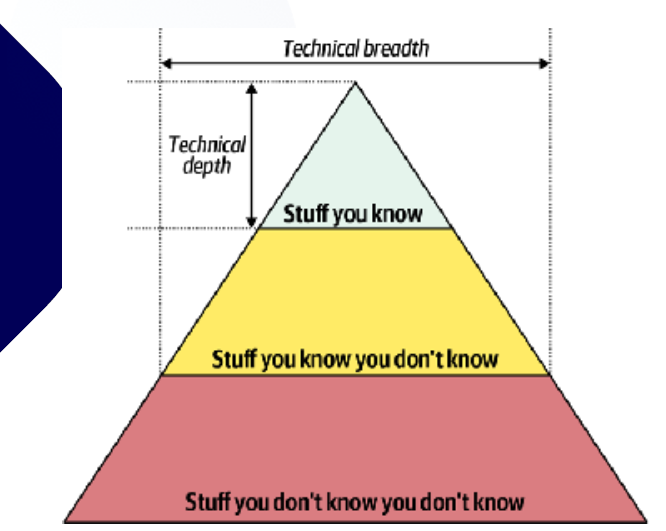

# Anotações — 02 Pensamento Arquitetural

## Aspectos do pensamento arquitetural

- Arquitetura vs Design
- Amplitude vs Profundidade Tecnica
- Analise de trade-offs
- Drivers de Negocio
- Arquiteto "mao na massa"

## O que eh pensamento arquitetural?

- Olhar de Arquiteto: Arquiteto deve sempre enxergar pontos fora da caixa
- Enfoque Sistemico: reconhecer impactos nas regras de negocio e no sistema antes de comecar a implementar
- Postura Colaborativa: proximo ao time de desenvolvimento, comunicando decisoes e ouvindo feedback

## Arquitetura vs Design: 

### Visao tradicional

- Responsabilidades do Arquiteto: 
    - analisar requisitos de negocio para definir caracteristicas arquiteturais
    - escolher estilo arquitetural adequado
    - planejar a estrutura de componentes do sistema
    - fazer tudo isso antes de implementar
- Responsabilidades do Desenvolvedor:
    - detalhar design de classes dentro dos componentes
    - implementar a interface 
    - escrever codigo-fonte
    - fazer testes
    - fazer ajustes
- Comunicacao unidirecional:
    - arquiteto planeja, desenvolvedor apenas aceita e segue
- Problemas resultantes:
    - decisoes arquiteturais podem nao ser implementadas fielmente
    - arquiteto nao percebe que o codigo esta fugindo da arquitetura desejada pois nao revisa, nao acompanha

### Colaboracao e Comunicacao Agil

- Quebrando barreiras:
    - colaborativo, se retro alimenta
    - feedback continuo de ambos os lados
    - processo de revisao mais proximo
    - devs podem ter insights positivos ao arquiteto
- Lideranca e Mentoria:
    - Arquiteto nao eh soh arquiteto, mas tambem lider tecnico e mentor

## Amplitude vs Profundidade de Conhecimento Tecnico

- profundidade - desenvolvedor
- amplitude - arquiteto

arquiteto deve ter uma main stack mas saber um pouco de outras coisas, enquanto o desenvolvedor precisa se especializar em sua main stack.
Isso faz com que o arquiteto sempre precise se atualizar na sua main stack e nas outras stacks tbm, tornando importante acompanhar influenciadores e early adopters das tecnologias.

## Analise de Trade-offs

